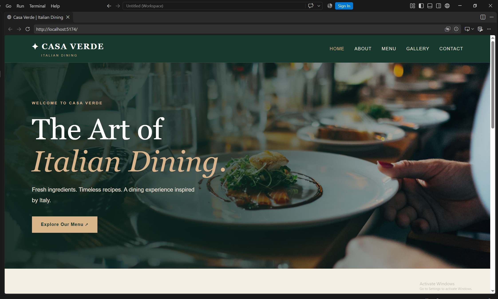
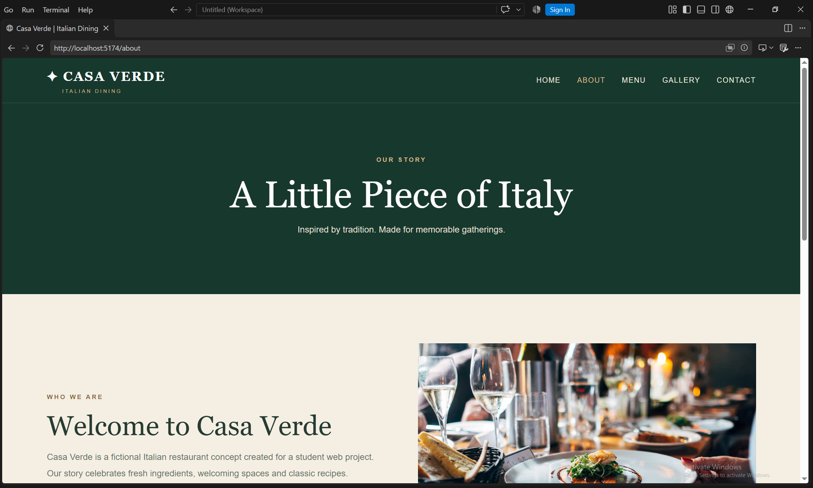
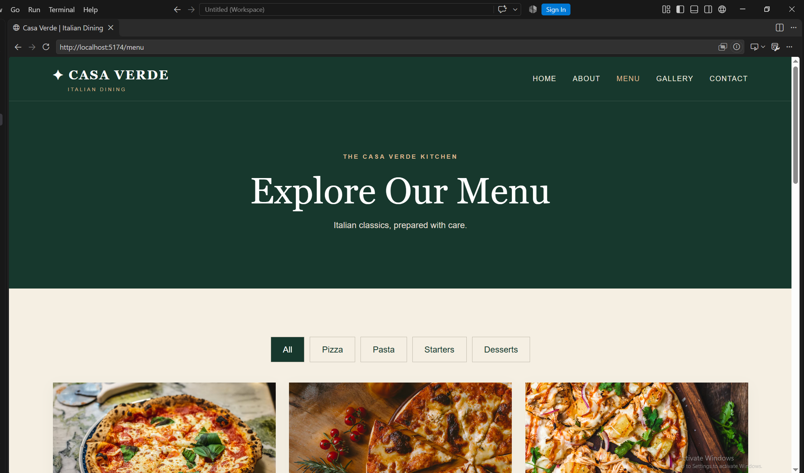
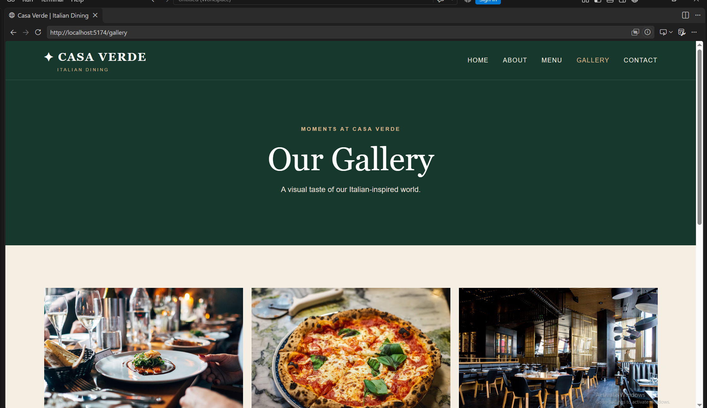
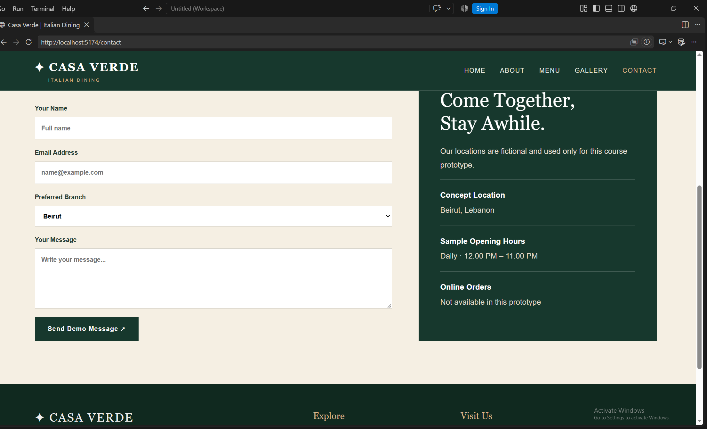

# Casa Verde — React restaurant website prototype
Live Website
Casa Verde is a responsive Italian restaurant website built using ReactJS.
Live Website: https://casa-verdee.netlify.app

GitHub Repository: https://github.com/jad-naboulsi/Casa-Verde

Features
Five pages: Home, About, Menu, Gallery, and Contact
Menu filtering by category
Responsive layout for desktop and mobile
Restaurant gallery
Contact form demonstration

A five-page Italian restaurant showcase built with React, React Router, Bootstrap CSS and custom CSS.

## Pages

- Home: welcome section and featured dishes
- About: restaurant story and fictional locations
- Menu: category filtering and sample dishes
- Gallery: photo gallery
- Contact: a local demo form (no messages are sent)

## Run locally

1. Install Node.js.
2. Open this folder in VS Code.
3. Run `npm install` in the terminal.
4. Run `npm run dev`.
5. Open the HTTP localhost URL printed in the terminal.

## Website Screenshots

### Home Page

### About Page

### Menu Page

### Gallery Page

### Contact Page

